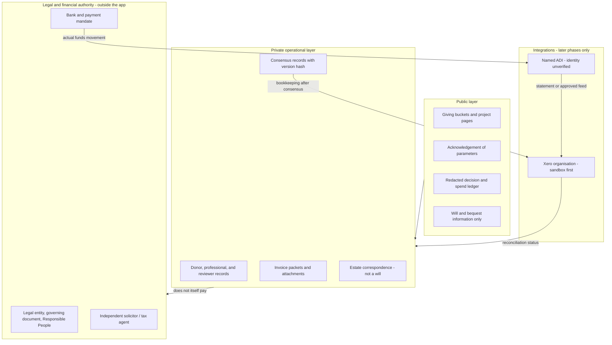
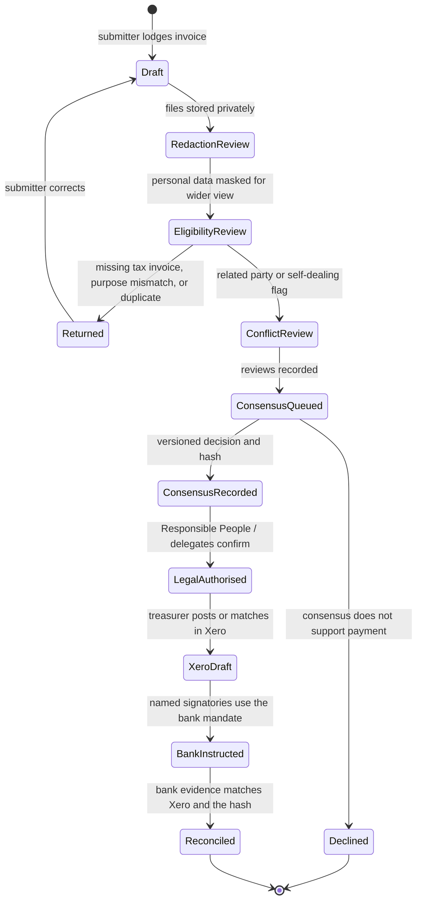
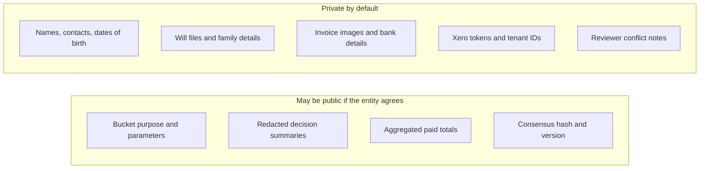

# Iteration 007 — Friends architecture

**Date:** Saturday 7 November 2026 (Australia/Sydney)  
**Status:** Documentation only. Not an implementation, product promise, legal opinion, tax ruling, or banking agreement.  
**Audience:** Design and review notes for a front-facing accounts transparency ledger and giving platform under Quaker ethos.

General information only. Verify current rules on official sites and with independently qualified Australian advisers. Not personal financial, tax, or legal advice. Australia only.

This document does not create a will, trust, Deductible Gift Recipient (DGR) entitlement, payment authority, token, investment, or bank connection.

## How to read this document

Claims are marked so design is not mistaken for law or for a finished product:

| Marker | Meaning |
|---|---|
| **Fact (source)** | Supported by an official page or statute citation fetched or otherwise checked on 7 November 2026 (Australia/Sydney). URLs and fetch notes are in [Sources](#13-sources-checked-7-november-2026-australiasydney). |
| **Design choice** | A proposed architecture decision for Friends. It is not required by law and is not already built. |
| **Historical wireframe claim** | Something earlier Woods notes asked a prototype to explore. It is not a fact about how money, law, or tokens work. |
| **Unverified / human check** | Needs a qualified human (solicitor, registered tax agent, the relevant entity’s Responsible People, banker, or Xero administrator) before anyone relies on it. |

## 1. Purpose and naming

**Design choice.** *Friends* is the current name for a front-facing accounts transparency ledger and giving platform. It is intended to help people:

1. dedicate units or amounts toward named purposes and projects;
2. explore will, bequest, and testamentary-trust pathways with independently qualified professionals who understand Quaker ethos;
3. see public acknowledgements of giving parameters without exposing private records;
4. submit and review community invoices;
5. let a treasurer post agreed bookkeeping into Xero only after a recorded consensus; and
6. keep any later link to an Australian authorised deposit-taking institution (ADI) separate from that bookkeeping step.

Older names appear only for provenance. Briefing language used “CouponDAO”. Remote Woods notes of 30 October 2026 used “Woods DAO” and “coupon or token”. Later local notes used “Q units”. Those names are historical. This file uses **Friends**.

**Unverified / human check.** Whether “Friends” can be used publicly without confusion with the Religious Society of Friends (Quakers), another Meeting, Australia Yearly Meeting (AYM), or an existing trade mark or domain has not been checked.

## 2. Provenance, checkout state, and what is not in the local notes

### 2.1 This checkout versus the expected remote

The expected remote is the private GitHub repository `v2-prog/Woods` (https://github.com/v2-prog/Woods), default branch `main`. It was inspected read-only on 7 November 2026. Reported head at inspection: `a4d68e4f133ad9f219f3316eadfe98f5d44c6f0d`. GitHub listed the repository as last updated 1 November 2026 (UTC).

The directory `/workspace/woods` contains Woods files but **is not a git working copy** (no `.git`). This file was written locally only. Nothing was committed or pushed.

Local iteration folders present before this file: `iterations/001` and `iterations/002`. Remote `main` already contains numbered folders `001` through `006`. Saving this document as local `003` would collide with remote `iterations/003/2026-10-31-domain-names.md`. **Design choice:** use `iterations/007/2026-11-07-friends-architecture.md`, the next free number on the expected remote.

The local copy of `iterations/001/2026-10-30-notes.md` is a shorter Y-frame note (2,868 bytes) and does **not** contain the Woods DAO wireframe. The remote file of the same path (8,096 bytes, blob `cdcf37bc7a7390582c9ecdd403dc3ae1c4a29000`) does contain a section titled “Woods DAO Web3 wireframe prompt (for Claude)”. This document treats that remote section, not the shorter local file, as the historical wireframe source. The local `001` file was not modified.

### 2.2 Historical wireframe claims (remote iteration 001, 30 October 2026)

The remote prompt asked for a mobile-first browser prototype, Australia only, with a prototype / not-financial-advice disclaimer, Next.js, Tailwind, and a **mock** Solana or Base token layer. It described five modules:

1. cooperative registry (eco-villages or land trusts, map pin, member count, land size, token circulation);
2. token dashboard (balance, staking yield, expiry countdown, wallet-connect transfer);
3. governance room (propose and vote on community spending, transparent ledger);
4. CoEconomics integration (life-stage modules unlocking governance weight or token rewards);
5. public think tank lounge (read discussions, request membership).

It also described a local “coupon or token” “backed one to one by fiat currency”, interest funding community development, and periodic expiry “to force circulation”. Palette recorded there: forest green `#1E4D38`, paper `#F3EFE4`, ink `#1C2416`, brass `#8A5A22`.

Those are **historical wireframe claims**, not findings that such an instrument is lawful, that interest belongs to a community fund, or that expiry can cancel a person’s rights.

A later local note outside this checkout (`/workspace/q-units/2026-11-02-q-units-notes.md`) restated the same three mechanics in “Q unit” language and already flagged ASIC, APRA, AUSTRAC, ATO, ACNC, and Australian Consumer Law gift-card questions as unchecked. Friends should keep that caution.

### 2.3 Related prior giving notes (remote iteration 006)

Remote `iterations/006` (1 November 2026) records a related public-facing giving design: lead with contributions and donations; distinguish tax-deductible from non-deductible streams; treat gifts under a will as non-deductible; align Xero tracking categories with those streams; keep personal donor data off any public budget view; and honour designated-purpose gifts rather than silently redirecting them.

Those notes also record user-supplied operational figures and local/national routing ideas. **Unverified / human check:** entity names, ACNC registration, DGR endorsement, quota arrangements, Xero category layout, and any reserve figure. This architecture does not treat those figures as facts and does not assume they are available to spend.

### 2.4 Reserve figure

**Unverified / human check.** A figure of about $168,000 in reserves was supplied by the user as context and also appears in other Woods planning notes as a planning assumption, not a verified balance. Friends must not treat that amount as cash backing, as spendable capacity, or as a public figure unless the relevant entity’s Responsible People verify it and decide what may be published.

## 3. Scope mapped to the six requested components

| # | Component | Friends treatment in this document |
|---|---|---|
| 1 | About 100 giving buckets (examples: climate change, First Nations, youth) | Public purpose taxonomy. Each bucket is a labelled purpose with its own receiving-entity, restriction, and deductibility facts. Deductibility is never implied by the bucket name. |
| 2 | Front-facing will / bequest / testamentary-trust help, with professionals drawn from Quaker society and ethos | Education, checklists, and a verified referral pathway. The platform does not create a legally effective will or trust. |
| 3 | Public acknowledgement of parameters | A public layer publishes purpose, restrictions, and process status. Private identities, contact details, health or family information, and full invoice images stay private. |
| 4 | Community invoice submission and review | A workflow with fraud, conflict, redaction, and duplicate checks before any consensus record. |
| 5 | Treasurer backend through Xero after consensus, then a link to an “Australia Bank” account | Consensus, Xero bookkeeping, and bank movement are three distinct authorities. |
| 6 | Security constraints of Xero and bank integrations | Minimal scopes, tenant separation, encrypted tokens, webhook signature checks or polling, no personal data on a public chain, and an incident plan. |

**Unverified / human check.** “Australia Bank” is not treated as a named ADI. See [7.8](#78-bank-identity-australia-bank-is-unverified).

## 4. Layer view

Three authorities must stay distinct:

1. **Community consensus** recorded by Friends (sense of the meeting, versioned proposal, hash).
2. **Legal authority** of the entity that owns the money (constitution or rules, committee minutes, delegated officers).
3. **Bank mandate** of named signatories on a specific account at a specific ADI.

A hash of a consensus record is evidence that a particular text was agreed. It is not a bank payment instruction.

## 5. Roles

| Role | What they can do | What they cannot do |
|---|---|---|
| Public visitor | Read bucket purposes, redacted parameters, and published decisions | See private identities, contact details, or raw invoices |
| Friend / donor | Make or indicate a living gift or dedication; state preferences | Bind the entity to spend outside its purposes; claim a tax deduction unless a real DGR receipt applies |
| Testator / will-maker | Read information and request a professional referral | Obtain a legally effective will from the website |
| Referred professional | Independently advise and prepare documents if qualified | Be “assigned” by software as if that created a solicitor–client relationship |
| Invoice submitter | Lodge an invoice and supporting files | Approve their own invoice or force payment |
| Reviewers | Check authenticity, purpose fit, conflicts, and redactions | Move money |
| Treasurer | Prepare Xero drafts and reconciliation after consensus | Treat a Xero payment allocation as a bank transfer |
| Finance committee / Responsible People | Discern and record decisions; set what is published | Outsource their duties to the app or to a fundraiser |
| Authorised bank signatories | Instruct the ADI under the account mandate | Be replaced by a consensus hash or by Xero |
| System operator | Run hosting, keys, logs, and incident response | Store secrets on a public chain or in client-side code |

**Fact (source).** For a registered charity, ACNC Governance Standard 5 requires Responsible People to act with care and diligence, in the charity’s best interests and for its charitable purposes, to disclose conflicts, and to manage financial affairs responsibly ([ACNC, *Managing charity money*](https://www.acnc.gov.au/tools/guides/managing-charity-money-guide-for-responsible-people), fetched 7 November 2026).

## 6. Legal layer

This section is general information about publicly stated Australian rules. It is not advice for any Meeting, donor, or estate.

### 6.1 Legal structure and eligible purposes

Friends is a software layer. It does not itself hold money. **Unverified / human check:** which legal person will operate Friends, hold any reserve, receive gifts, appear on receipts, and be named in a will. Candidates commonly considered for a religious or community group — an incorporated association, a company limited by guarantee, a trust, a co-operative, or an existing Meeting or Yearly Meeting entity — have not been chosen here.

**Fact (source).** Registration as a charity with the ACNC requires a charitable purpose listed in the *Charities Act 2013* (Cth). The twelve purposes include advancing health, education, social or public welfare, religion, culture, reconciliation and mutual respect, human rights, security or safety of the public, preventing or relieving animal suffering, advancing the natural environment, other similar purposes beneficial to the general public, and certain advocacy that furthers those purposes ([ACNC, *Charitable purpose*](https://www.acnc.gov.au/for-charities/start-charity/you-start-charity/charitable-purpose), fetched 7 November 2026). All purposes must be charitable, except incidental or ancillary purposes. Promoting or opposing a political party or candidate cannot be a charitable purpose.

**Fact (source).** Charity registration and DGR endorsement are different things. From 14 December 2021, non-government DGRs generally must also be registered charities, with exceptions including ancillary funds and DGRs listed by name in the tax law ([ATO, *DGR categories*](https://www.ato.gov.au/businesses-and-organisations/not-for-profit-organisations/getting-started/getting-endorsed-for-tax-concessions-or-as-a-dgr/is-my-organisation-eligible-for-dgr-endorsement/dgr-categories), last updated 4 September 2025, fetched 7 November 2026).

**Design choice.** Until the operating entity and its ACNC subtypes are confirmed, every public Friends page should say which named entity would receive funds for that bucket, and should not describe Friends itself as the charity or the DGR.

### 6.2 DGR status and tax-deductible claims

**Fact (source).** A donor can claim an income-tax deduction for a gift only if, among other things, the recipient has DGR status at the time of the gift, the transfer is truly a gift (voluntary, and without a material benefit or advantage in return), the gift is of money or eligible property, and any extra gift conditions in the tax law are met ([ATO, *Gifts and donations*](https://www.ato.gov.au/Individuals-and-families/Income-deductions-offsets-and-records/Deductions-you-can-claim/Gifts-and-donations/), last updated 6 July 2026, fetched 7 November 2026). Not all charities are DGRs. Donations to many crowdfunding or social-media campaigns are not deductible. DGR status can be checked on [ABN Lookup](https://abr.business.gov.au/).

**Fact (source).** The ATO lists 52 general DGR endorsement categories, grouped as health, education, research, welfare and rights, defence, environment, the family, international affairs, sports and recreation, cultural organisations, fire and emergency services, ancillary funds, and community charities. Some categories have extra gift conditions. Organisations that do not fit a category may seek listing by name only in exceptional cases, via a written request to the Treasurer, not via the ATO ([ATO, *DGR categories*](https://www.ato.gov.au/businesses-and-organisations/not-for-profit-organisations/getting-started/getting-endorsed-for-tax-concessions-or-as-a-dgr/is-my-organisation-eligible-for-dgr-endorsement/dgr-categories)).

Advancing religion is a charitable purpose for ACNC registration. The fetched ATO DGR-category page does not list a general “advancing religion” endorsement category. The ATO’s gifts page includes “religious organisations” among examples of gifts a person cannot claim where DGR status is absent ([ATO, *Gifts and donations*](https://www.ato.gov.au/Individuals-and-families/Income-deductions-offsets-and-records/Deductions-you-can-claim/Gifts-and-donations/)). **Unverified / human check:** whether any specific Quaker entity, or a fund it operates, is endorsed as a DGR and for which item number. Do not publish “tax deductible” on a bucket until that endorsement, and any gift condition, is confirmed on ABN Lookup for the named recipient.

**Fact (source).** A testamentary gift or contribution is not deductible under section 30-15 of the *Income Tax Assessment Act 1997* (Cth). The ATO has applied that rule to money paid by an executor under a will ([ATO ID 2003/173](https://www.ato.gov.au/law/view/document?docid=AID/AID2003173/00001), fetched 7 November 2026; see also the ATO gifts page: “donations made under a will”).

**Fact (source).** The ATO also states that donations made under a salary-sacrifice arrangement are not claimable as a gift deduction by the donor ([ATO, *Gifts and donations*](https://www.ato.gov.au/Individuals-and-families/Income-deductions-offsets-and-records/Deductions-you-can-claim/Gifts-and-donations/)). Public copy must not describe salary packaging as a personal gift deduction.

**Fact (source).** From 1 July 2026 the former $2 minimum threshold for gift deductions was removed, backdated to eligible gifts from 1 July 2024, and does not apply to political donations ([ATO, *Gifts and donations*](https://www.ato.gov.au/Individuals-and-families/Income-deductions-offsets-and-records/Deductions-you-can-claim/Gifts-and-donations/)).

**Design choice.** Friends should store, for every receipt or acknowledgement: recipient legal name, ABN, whether the receipt is a DGR gift receipt or only an acknowledgement, donor identity (private), date, amount, bucket, and a clear statement of any benefit provided. Public pages show only what the entity has agreed to publish.

### 6.3 Giving buckets

**Design choice.** “About 100” is a taxonomy size, not a legal category count. Each bucket needs at least:

- stable public identifier and plain-language name;
- purpose statement that a reviewer can match to an invoice;
- named receiving entity, ABN, and ACNC subtype if any;
- DGR status: none / whole-entity / specified fund only, plus any gift condition;
- restriction type: unrestricted, preference (non-binding wish), or accepted restricted purpose;
- whether living gifts and estate pledges are both accepted;
- cultural-safety notes (especially for First Nations buckets);
- public acknowledgement text and retention rules.

Example labels such as climate change, First Nations, and youth are not themselves DGR categories. They may or may not line up with ACNC purposes (for example advancing the natural environment, promoting reconciliation, advancing education, or advancing social or public welfare) and with a separate ATO DGR item. **Unverified / human check:** mapping of each bucket before any deductibility language is shown.

**Design choice.** First Nations buckets should not be opened as decorative labels. Any such bucket needs the receiving entity’s own authority, culturally appropriate governance, and a human review of consultation and conflict issues before publication.

**Design choice.** If a living donor wants a deduction, Friends should route only to a bucket whose named recipient is an active DGR for that purpose. Other buckets can still receive non-deductible contributions or bequests.

### 6.4 Donor control, restricted gifts, and grant limits

A living gift, once completed, is generally a transfer of money or property. The donor does not retain day-to-day control of the entity.

**Fact (source).** For a deduction, the ATO requires a true gift without a material benefit or advantage in return ([ATO, *Gifts and donations*](https://www.ato.gov.au/Individuals-and-families/Income-deductions-offsets-and-records/Deductions-you-can-claim/Gifts-and-donations/)). Extra “control” that looks like the donor is buying a service, securing a personal advantage, or directing funds back to themselves is a deductibility and governance risk.

**Fact (source).** Responsible People must apply charity money, less reasonable expenses, toward the charity’s charitable purpose, keep adequate records, and put controls in place against fraud and misuse ([ACNC, *Managing charity money*](https://www.acnc.gov.au/tools/guides/managing-charity-money-guide-for-responsible-people)). Fundraising is regulated by states and territories, not by the ACNC. Registration or a permit may be required where the charity fundraises.

How far a designated-purpose gift is legally binding depends on the words used, the entity’s governing document, trust principles, and any grant contract. Prior Woods notes treated designated gifts as needing to be honoured and not redirected without consent. That is a prudent operational stance and a **human check** for a solicitor, not a conclusion of this document.

**Design choice.** Friends should distinguish:

- *preference* — recorded wish, publicly acknowledged, not a promise the entity cannot later vary if the purpose fails or is unlawful;
- *accepted restriction* — the entity has agreed to receive the gift for a stated purpose and to track it separately;
- *grant or contract* — conditions that are contractual, with their own reporting duties.

If a purpose becomes impossible, unlawful, or outside the entity’s objects, software must not invent a redirection. That is a legal and governance decision (including any cy-près or court or regulator process). Flag it for humans.

AYM’s public Thanksgiving Fund page invites Friends to consider the Fund when making wills and notes that bequests may be of property. It identifies The Religious Society of Friends (Quakers) in Australia, incorporated in the ACT, ABN 16 036 715 933 ([AYM, *Gifts to the Fund*](https://www.quakersaustralia.info/Thanksgiving/gifts-fund), fetched 7 November 2026). **Unverified / human check:** current handbook wording for local versus national naming, and whether a local Meeting must be named in full if local administration is intended. Prior Woods notes recommended simple, general wording and a clause allowing sale of bequeathed property; that remains a human check against the live handbook.

### 6.5 Wills and bequests — state and territory dependent

**Design choice.** Friends may publish general information, a checklist, and suggested topics to discuss with a qualified practitioner. It must not generate a filled will that is presented as ready to sign, and it must not tell a user that clicking through the site has created a will.

Will-making law is not uniform across Australia.

**Fact (source).** In New South Wales, section 6 of the *Succession Act 2006* (NSW) requires a will to be in writing; signed by the will-maker or by another person in the will-maker’s presence and at their direction; with that signature made or acknowledged in the presence of two or more witnesses present at the same time; and with at least two witnesses attesting and signing in the will-maker’s presence (they need not sign in each other’s presence). The signature must be made with the intention of executing the will (State Library of NSW restatement of s 6, [Making a valid will](https://www.sl.nsw.gov.au/find-legal-answers/books-online/rest-assured-legal-guide-wills-estates-planning-ahead-and-funerals/making-a-valid-will), fetched 7 November 2026). The same guide notes courts may sometimes admit an informal document under s 8; that a beneficiary should generally not witness; that marriage, revocation, residue, debts, and overseas wills have their own rules; and that professional help is recommended for trusts and complex estates.

**Fact (source).** Victoria Legal Aid states that a valid Victorian will must be in writing and signed in front of two or more witnesses, and that the will-maker must have testamentary capacity. Victoria also describes an audio-visual witnessing pathway with extra conditions, including that one witness is a lawyer or justice of the peace, all sign on the same day, and a statement of compliance is included ([Victoria Legal Aid, *Making a valid Will*](https://www.legalaid.vic.gov.au/making-valid-will), updated 10 April 2026, fetched 7 November 2026). That remote-witnessing detail is already different from the NSW summary above.

**Unverified / human check.** Equivalent formalities, remote-witnessing rules, interested-witness rules, revocation by marriage or divorce, family-provision risk, and international assets must be checked against the law of the jurisdiction where the will-maker lives and where property is situated. Direct fetches of the Victorian *Wills Act 1997* s 7 and Queensland *Succession Act 1981* s 10 from AustLII timed out on 7 November 2026; a solicitor should read the in-force official text for the relevant jurisdiction.

An estate pledge recorded in Friends is not a will. It is at most a planning note or an expression of intention. It must be stored as `estate_pledged`, not as cash and not as a legally effective disposition.

### 6.6 Testamentary trusts

**Fact (source).** The NSW State Library guide describes a testamentary trust as a will under which the estate is not left outright to beneficiaries but is held by a trustee on conditions set in the will. It strongly recommends using a lawyer, a private trustee company, or the NSW Trustee and Guardian to draft such a will, and lists common reasons people consider a trust (tax, disability, addiction, minority, or more than one family) ([Making a valid will](https://www.sl.nsw.gov.au/find-legal-answers/books-online/rest-assured-legal-guide-wills-estates-planning-ahead-and-funerals/making-a-valid-will)).

**Design choice.** Friends may explain, in general terms, that a testamentary trust is created by a valid will and takes effect on death, and that “some level of control” after death is a drafting and trustee-power question for a qualified practitioner. The site must not assemble trust deeds or appoint trustees.

**Unverified / human check.** Tax treatment of testamentary trusts (including excepted trust income rules), stamp duty, social-security effects, and trustee duties all need advice on the actual facts. No conclusion is drawn here.

### 6.7 Ethical professional pathways

**Fact (source).** In Victoria it is a criminal offence to engage in unqualified legal practice or to claim to be qualified when not. A person is qualified only if they are an Australian legal practitioner holding a current practising certificate. Drafting or advising on the terms of a will is given as an example of legal practice. Doing the work for free, only once, accurately, or while disclosing that one is unqualified does not stop it being unqualified legal practice. Users of unqualified services are not protected by professional indemnity insurance or the local compensation scheme ([Victorian Legal Services Board and Commissioner, *Unqualified legal practice*](https://lsbc.vic.gov.au/consumers/registers-lawyers/unqualified-legal-practice), last updated 26 June 2026, fetched 7 November 2026). Other states and territories have equivalent prohibitions; the exact statute should be confirmed for the practitioner’s jurisdiction.

**Design choice.** Friends should offer a **referral directory**, not software “assignment” of a professional as if the platform were instructing counsel.

Minimum directory rules:

- verify a current Australian practising certificate on the relevant public register, and the jurisdiction of practice;
- record the area of work actually offered (wills, estates, charitable trusts), not merely Quaker membership;
- require the practitioner’s written consent to be listed;
- disclose any conflict or association with the receiving entity, finance committee, or a named bucket;
- prefer independent practitioners where the receiving entity would benefit under the will;
- make clear that the will-maker chooses the practitioner and enters a separate retainer;
- prohibit site copy that uses protected titles for people who are not practitioners;
- do not draft operative will or trust wording in the product UI.

“From within the Quaker society and its ethos” can inform who is invited to apply for listing. It cannot replace admission, a practising certificate, competence, or conflict rules. Pastoral support and legal advice are different roles.

### 6.8 Units are not automatically crypto, money, or an investment

**Design choice for early phases.** Treat a “unit” as an internal unit of account: one unit records one Australian dollar of received, dedicated, or acknowledged value in Friends’ own ledger. Do not issue a transferable on-chain token, do not offer redemption as electronic cash, and do not promise a personal return.

Whether a later instrument is a financial product depends on actual rights, marketing, and use, not on the word “unit”.

**Fact (source).** ASIC Information Sheet 225 explains that a facility through which a person can make non-cash payments to more than one person is generally a financial product (*Corporations Act 2001* (Cth) s 763D), and that digital-asset wallets and some stablecoins can be non-cash payment facilities. A yield-bearing stablecoin whose contributions are pooled to generate a return for holders is given as an example that is likely an interest in a managed investment scheme. A non-interest-bearing AUD stablecoin, issued at par, redeemable on demand, and used as a means of payment, is given as an example that is likely a non-cash payment facility. Providing financial services in relation to such products generally requires an Australian financial services licence unless an exemption applies. ASIC also notes government consultation on digital-asset platforms and on payment-service reforms that may regulate certain stablecoins ([ASIC, INFO 225](https://www.asic.gov.au/regulatory-resources/digital-transformation/digital-assets-financial-products-and-services), fetched 7 November 2026).

**Historical wireframe claim versus that guidance.** A 1:1 fiat-backed transferable token with wallet-connect transfer looks closer to the payment-stablecoin example. Adding “staking yield” to holders looks closer to the yield-bearing example. Routing reserve interest only to a community fund, as later Q-unit notes preferred, may reduce that particular investment characterisation, but it does not decide the non-cash-payment question. No conclusion is drawn here. **Unverified / human check:** licensed advice before any transferable or redeemable unit is offered.

**Fact (source).** AUSTRAC now uses “virtual asset” rather than “digital currency”. A virtual asset is a digital representation of value that can be transferred, stored or traded electronically, is not issued by a government body, and functions as a medium of exchange, store of value, unit of account or investment, or enables governance voting on such arrangements. Exchanging virtual assets for money, exchanging virtual assets for virtual assets, providing virtual-asset safekeeping, and certain transfer and offer-related services can be designated services with a geographical link to Australia ([AUSTRAC, *Virtual asset designated services*](https://www.austrac.gov.au/new-austrac/designated-services-newly-regulated-entities/virtual-asset-designated-services), last updated 16 October 2026, fetched 7 November 2026). AUSTRAC excludes money held in an account, some loyalty points, and “the mere representation of value in digital form where it is the underlying asset that may be transferred rather than the digital representation itself” (example given: a simple digital record of owning shares). An internal bookkeeping unit that never leaves the entity’s ledger is closer to that last idea, but **human check** is still required if units become transferable, redeemable, or issued in the course of a business.

**Fact (source).** Holding a pooled store of value may also raise stored-value / purchased-payment-facility questions under the *Banking Act 1959* (Cth). APRA’s register separately lists “Providers of purchased payment facilities” (PayPal Australia Pty Limited and Wise Australia Pty Ltd as at the 15 October 2026 update) ([APRA ADI list](https://www.apra.gov.au/registers/list-registered-authorised-deposit-taking-institutions), fetched 7 November 2026). Whether a community reserve would ever fall on that side of the line is a human check, not a conclusion.

### 6.9 Expiry and consumer law

**Historical wireframe claim.** Periodic expiry was proposed “to force circulation”.

**Fact (source).** Under the Australian Consumer Law, most gift cards supplied on or after 1 November 2019 must be redeemable for at least three years from supply or purchase, must display the expiry (or say there is no expiry), and must not impose post-supply fees. There are listed exceptions, including reloadable cards, some promotional donations, customer loyalty programs, and cards supplied to certain charities or government agencies ([ACCC, *Gift cards and discount vouchers*](https://www.accc.gov.au/consumers/advertising-and-promotions/gift-cards-and-discount-vouchers), fetched 7 November 2026).

**Unverified / human check.** Whether any Friends unit or voucher would be a “gift card” under those rules depends on how it is supplied and used. Even if an exception applies, expiry still cannot quietly confiscate a completed gift, a restricted-purpose obligation, a contractual right, or trust property. **Design choice:** do not implement expiry or demurrage in any phase that handles real value. If it is ever reconsidered, the default story should be a reminder to spend or gift with informed consent, after legal review — not automatic forfeiture.

### 6.10 Privacy, fundraising, and other compliance

**Unverified / human check.** Whether the operator is an APP entity under the *Privacy Act 1988* (Cth) depends on turnover, activities (including health services), and other tests. Fundraising may need a state or territory authority. Invoice packets may contain tax invoices, personal information, or sensitive information and must be stored and redacted accordingly. This document does not determine those obligations.

## 7. Financial layer

### 7.1 Fund classes

**Design choice.** Every dollar-equivalent in Friends belongs to exactly one class:

| Class | Meaning | Can invoices spend it? |
|---|---|---|
| `unrestricted_spendable` | Received cash (or cleared receivables) the entity may apply to its objects | Yes, after consensus and legal authority |
| `restricted_spendable` | Received cash accepted for a stated purpose | Only for matching purposes |
| `operating_floor` | Minimum balance the committee chooses to retain | No, unless the committee changes the floor |
| `reserve_backing` | Amount held against recorded units or dedications, if any units exist | Only if the matching liability is reduced lawfully |
| `estate_pledged` | A stated testamentary intention or notified expectant bequest | No. Not an asset until the estate actually pays |
| `committed_unpaid` | Approved invoices not yet paid by the bank | Reduces apparent available cash |
| `interest_community` | Interest the entity has actually received and allocated to community purposes | Only after the same consensus and authority path |

Do not assume the unverified $168,000 figure sits in any of these classes. Do not add estate pledges to spendable totals or to any public “reserves” chart.

### 7.2 Reserve backing and liability ledgers

If Friends later records units, it needs two ledgers that always reconcile:

- **Asset / backing view:** AUD actually held at the named ADI (and any separately identified pool), broken down by fund class.
- **Liability / dedication view:** units or dedications outstanding, restricted balances, and unpaid approved invoices.

**Historical wireframe claim.** One token equals one dollar of reserve. That can be a bookkeeping invariant only if issuance happens after cleared funds arrive, and redemption or expiry (if any are ever lawfully offered) happens only by reducing the matching liability. Software cannot invent backing.

Interest earned on an ADI deposit is received by the account holder, not by individual donors, unless a legally effective arrangement says otherwise. **Unverified / human check:** income-tax treatment if the holder is not income-tax exempt; whether interest is restricted by the same purpose as the principal; and how it should be described publicly.

### 7.3 Expiry cannot confiscate rights

Even as a design discussion, expiry of a displayed unit must not:

- cancel a completed gift or a restricted-purpose obligation;
- take a depositor’s redeemable balance if a redeemable facility has been created;
- override consumer-law gift-card rights if those rights apply;
- treat an estate pledge as expired value the community now owns.

Any value that “moves to the community fund” needs a lawful basis (gift terms, governing document, or informed later consent).

### 7.4 Invoice to money movement

Xero invoice approval or a Xero payment allocation is bookkeeping. It does not move funds at an ADI.

The official Xero Payments API page (`https://developer.xero.com/documentation/api/accounting/payments`) returned no usable body when fetched on 7 November 2026, so its current wording is a **human check**. What is source-supported is that Xero now splits the old broad `accounting.transactions` scope into `accounting.invoices`, `accounting.payments`, `accounting.banktransactions`, and `accounting.manualjournals`, each with a `.read` variant ([Xero, *Granular Scopes FAQs*](https://developer.xero.com/faq/granular-scopes), fetched 7 November 2026). That split itself shows invoices, payment records, and bank transactions are different permissions. **Design choice:** Friends must never treat a successful Xero payments API call as proof that a bank paid someone.

### 7.5 Consensus proof is not a bank authority

**Design choice.** A consensus record should store: proposal text, bucket or project, amount, invoice references, who discerned, the decision, timestamp (Australia/Sydney and UTC), document version, and a hash of the canonical payload. Publish the hash and a redacted summary if the committee so decides.

Payment still requires whatever the entity’s governing document and the bank’s mandate require (often two signatories). ACNC guidance lists multiple signatures on payments as an example of a strong financial control ([ACNC, *Managing charity money*](https://www.acnc.gov.au/tools/guides/managing-charity-money-guide-for-responsible-people)).

### 7.6 Invoice fraud, redaction, and conflicts

**Design choice.** Before consensus, reviewers check:

- supplier identity and whether the submitter is related to the supplier or the project;
- tax-invoice content if GST is relevant (identity, ABN, invoice number, date, description, amount);
- duplicate invoice numbers, repeated PDFs, or repeated amounts and dates (idempotency);
- purpose fit to the named bucket and any restriction;
- whether the amount would break the operating floor or restricted balance;
- what must be redacted before any wider or public view (addresses, account numbers, medical or family details, children’s information).

False invoices and related-party claims are a stated fraud risk in ACNC guidance. Reviewer comments stay private. Public acknowledgement can say that an invoice was received, reviewed, agreed or declined, and paid, without publishing the raw file.

### 7.7 Reconciliation

**Design choice.** A payment is `reconciled` only when all of the following match on amount, date window, supplier, and invoice identity:

1. consensus hash and legal authorisation record;
2. Xero invoice and (after the fact) Xero payment or matched bank transaction;
3. independent bank evidence (statement line, export, or an approved feed).

Retries must be idempotent. Duplicate Xero posts and duplicate bank instructions are defects, not “extra transparency”.

### 7.8 Bank identity: “Australia Bank” is unverified

**Unverified / human check.** The brief’s phrase “Australia Bank” is not taken to identify any ADI, product, API, or agreement. No banking access, feed, or payment initiation is promised.

**Fact (source).** APRA’s register of ADIs, updated 15 October 2026 and fetched 7 November 2026, includes among many others Australia and New Zealand Banking Group Limited, Australian Military Bank Ltd, Auswide Bank Ltd, Bank Australia Limited, and Regional Australia Bank Ltd. It does not list an entity whose registered name is simply “Australia Bank” ([APRA ADI list](https://www.apra.gov.au/registers/list-registered-authorised-deposit-taking-institutions)). Close names are not interchangeable. The correct legal name, BSB, account, signatories, and any API or service agreement must be confirmed with the entity and the institution before integration work.

Possible later bank-side channels, each requiring its own contract and risk assessment, include: human dual-authorisation via the bank’s existing channels; an accountant-prepared file uploaded by signatories; the bank’s own corporate-payment API if offered to that customer; or a licensed payment provider. None of these is selected here.

### 7.9 Consumer Data Right boundaries

**Fact (source).** The Consumer Data Right lets a consumer consent to designated data holders sharing data about them with accredited recipients. Treasury leads policy; the ACCC accredits recipients and runs the register; the OAIC oversees privacy safeguards. Banking data sharing began on 1 July 2020 and all Australian banks are required to participate. Energy followed. Non-bank lender consumer data sharing is scheduled from 9 November 2026 on the ACCC page fetched on 7 November 2026 ([Treasury CDR overview](https://treasury.gov.au/policy-topics/economy/consumer-data-right); [ACCC, *The Consumer Data Right*](https://www.accc.gov.au/by-industry/banking-and-finance/the-consumer-data-right)).

The official [CDR rollout page](https://www.cdr.gov.au/rollout) (fetched 7 November 2026) describes staged **data-sharing** obligations. It records that legislation to extend the framework to enable action initiation was introduced in 2022 and passed in August 2024, and that earlier funding included work to progress design of action initiation. The same page does not describe any live consumer payment-initiation or other action-initiation service.

**Design choice.** Do not use CDR as a payment rail. Do not collect CDR consents unless the operator is an accredited data recipient (or an authorised representative) and has a specific, lawful data-sharing use. Open-banking consent to share statements is not authority to debit an account.

## 8. Technical layer

### 8.1 Suggested shape for a later prototype

**Historical wireframe claim.** Next.js, Tailwind, mobile-first, mock Solana or Base.

**Design choice.** Keep that stack for a read-only or clickable prototype if desired, including the recorded Woods palette and an Australia-only prototype disclaimer. Use a conventional server-side ledger for any real data. Defer real tokens, wallets, and public chains. If a later phase ever needs a chain, it should be a separate, licensed project, and no personal data or secrets should go on a public chain.

### 8.2 Public versus private data

**Design choice.** Public acknowledgement of parameters can include: bucket purpose, restriction type, named receiving entity, whether living gifts are claimed as deductible (only if verified), whether estate pledges are accepted, review status, and a redacted spend total. It should not include donor names unless the donor gave informed consent to be named.

### 8.3 Core data model

Logical records only; no schema has been implemented.

- `Entity` — legal name, ABN, ACNC charity (yes/no), DGR status and item, governing-document version.
- `Bucket` — as in [6.3](#63-giving-buckets).
- `Project` — optional child of one or more buckets, with its own budget cap.
- `Dedication` — living gift or internal allocation; amount; fund class; status.
- `EstatePledge` — non-asset expression of intention; never spendable.
- `Professional` — register checks, jurisdiction, consent, conflicts.
- `Referral` — request, chosen practitioner, no document output stored as a will unless the user later uploads their own copy.
- `Invoice` — supplier, amounts, files, idempotency key, review states.
- `Review` — reviewer, outcome, conflict declaration, redaction map.
- `ConsensusRecord` — canonical payload, version, hash, decision.
- `LegalAuthorisation` — distinct from consensus; officer or minute reference.
- `XeroLink` — tenant ID, granted scopes, token metadata (not raw tokens in logs).
- `BankMandate` — ADI legal name (once verified), account reference, signatory list, **no** full account secrets in the public app.
- `Reconciliation` — links consensus, Xero IDs, and bank evidence IDs.
- `AuditEvent` — who, what, when, previous hash; append-only.

### 8.4 Historical modules mapped onto Friends

| Historical module | Friends equivalent | Phase |
|---|---|---|
| Cooperative registry | Optional directory of participating Meetings or projects, without token-circulation claims | Late, if wanted |
| Token dashboard | Dedication and fund-class dashboard; no personal yield | After a real ledger exists |
| Governance room | Consensus records and redacted public ledger | From the first private workflow |
| CoEconomics panel | Optional education link only; do not mint units as rewards | Deferred |
| Public think tank lounge | Out of scope for the transparency ledger unless separately specified | Deferred |

### 8.5 Xero integration constraints

**Fact (source).** Xero requires OAuth 2.0. OAuth 1.0a is not compliant. Refresh tokens must be encrypted in persistent storage with a symmetric algorithm (AES-128 or greater preferred) and the AES key stored separately from the tokens. Tokens and customer-identifying information must not be exposed in the app or shared with other parties. TLS 1.2 with AES-256 and SHA-256 is mandatory in transit. Sensitive commercial or personal information must be encrypted at rest. Apps should use strong customer authentication (at least two-step or SSO). Audit logs should be immutable, kept in most cases for at least one year, and include time, actor, event, success or failure, and source. Anomalies must be reportable to Xero. These requirements come from [Xero’s security standard for API consumers](https://developer.xero.com/partner/security-standard-for-xero-api-consumers) (fetched 7 November 2026). That page also states a formal annual self-assessment obligation for consumers above stated connection thresholds or using certain Xero practice products; whether a small Friends app would later fall in that cohort is a human check.

**Fact (source).** Apps created on or after 2 March 2026 use granular scopes. Users must re-consent if requested scopes change. Calling an endpoint without the matching scope returns `401` with `WWW-Authenticate: insufficent_scope`. Xero recommends a separate test app and the Demo Company ([Xero, *Granular Scopes FAQs*](https://developer.xero.com/faq/granular-scopes)).

**Design choice.** Request only the scopes the current phase needs. A read-only prototype should use `.read` invoice and contact scopes, not `accounting.payments` or bank-write scopes. Add write scopes later, after sandbox tests and after the entity’s Xero administrator explicitly connects the app to the correct tenant. Store the Xero organisation / tenant ID and refuse to act on any other tenant.

Direct fetch of Xero’s webhook server-configuration page returned “Not Authorized” on 7 November 2026. The same official URL is publicly indexed as requiring HMAC-SHA256 of the raw payload with the webhook signing key, comparison to the `x-xero-signature` header, HTTP 401 for a bad signature, a 2xx response within five seconds, HTTPS on port 443, and retries for up to 24 hours after which Xero disables the subscription ([Xero, *Configuring your server*](https://developer.xero.com/documentation/guides/webhooks/configuring-your-server) — fetch blocked; treat details as needing confirmation against the live page). **Design choice:** verify signatures before any processing; if webhooks are unavailable or fail intent-to-receive checks, poll the Accounting API on a documented schedule and keep both paths idempotent.

Token revocation and rotation: on staff change, suspected compromise, or tenant disconnect, delete refresh tokens, revoke the Xero connection, rotate the token-encryption key if exposure is possible, invalidate sessions, and write an incident record. Do not log raw tokens.

Xero bank feeds are a separate product from the Accounting API payment record. Friends should not try to impersonate a bank feed provider. Bank evidence should come from the entity’s existing Xero bank-feed connection, a statement export provided by authorised people, or a later bank product that has been verified.

### 8.6 Security threats

| Threat | Why it matters here | Mitigation in later build |
|---|---|---|
| Unqualified will or trust output | Users may think a downloadable document is legally effective | Information and referral only; repeated disclaimers; no operative document generation |
| False deductibility claims | Penalties for the donor and the entity | Show DGR language only after ABN Lookup verification for that recipient and purpose |
| Invoice fraud or duplicates | Charity funds can be stolen with false bills | Multi-person review, idempotency keys, related-party flags, bank dual control |
| Treating consensus or Xero as payment | Money may be thought paid when it is not | Separate states; reconciliation required |
| Over-broad Xero scopes | A compromised app could alter or pay across the books | Minimal granular scopes; tenant allow-list |
| Stolen refresh tokens | Persistent access to the Xero organisation | AES encryption at rest, separate key, rotation, revocation |
| Forged webhooks | Fake invoice or payment events | Signature check; 401 on failure; poll fallback |
| Compromised treasurer account | Both books and, separately, bank access | SSO or MFA, break-glass revocation, dual bank signatories that do not live in the app |
| Public-chain personal data | Irreversible disclosure | No personal data or secrets on a public chain; defer tokens |
| Publishing estate or health details | Privacy and pastoral harm | Strict public/private split and redaction |
| Assuming the $168k or a named bank | False public accounts | Unverified figures stay unpublished |
| CDR consent reused as a debit authority | Unlawful or unauthorised payments | CDR, if ever used, is read-sharing only |

### 8.7 Incident response (design)

On suspected compromise of a Friends, Xero, or treasurer login:

1. revoke sessions and Xero tokens;
2. rotate encryption keys if tokens may have been copied;
3. freeze outbound invoice-to-payment automation (there should be none in early phases);
4. notify authorised signatories to watch or freeze the bank channel using the bank’s own process;
5. preserve immutable logs;
6. notify Xero where the security standard requires it, and consider OAIC or ACNC notification duties;
7. do not reconnect production scopes until a written all-clear.

## 9. Phased build and gates

No phase below has been implemented by this document.

| Phase | What may be built | Gate before leaving the phase |
|---|---|---|
| 0. Paper and clickable prototype | Public information architecture, sample buckets, disclaimers, fake numbers clearly marked as fiction | Human review that no page claims DGR status, legal effectiveness, or a named bank |
| 1. Read-only transparency prototype | Real bucket copy only after entity approval; no accounts that accept money | Entity identity and purpose text checked by Responsible People |
| 2. Private invoice and consensus workflow | Submission, redaction, review, hashed decisions; no Xero write and no bank | Dual-review path works; public site still shows only redacted fields |
| 3. Xero sandbox | Demo Company or separate test organisation; read-only then carefully scoped write of test invoices | Granular scopes minimised; token encryption verified; webhook signatures or polling proven; production tenant not connected |
| 4. Xero production bookkeeping | Post or match invoices after consensus and legal authorisation | Written authority from the entity’s Xero administrator; tenant ID pinned; rollback and disconnect drill completed |
| 5. Bank evidence only | Import or match statements or an already-authorised Xero bank feed | ADI legal name, account, and mandate verified; still no app-initiated payment |
| 6. Optional payment instruction | Only if a specific bank or licensed payment product is contracted | Separate legal, security, and dual-control review; never via undesignated CDR action initiation |
| Deferred | Real tokens, wallet connect, public chain, staking or yield, expiry or demurrage, automatic wills or trusts, CoEconomics reward minting | Licensed advice and a new architecture revision |

**Design choice.** Keep a visible prototype disclaimer on every pre-production screen: exploration only, general information, not financial, tax or legal advice, Australia only, no real tokens.

## 10. Suggested acceptance tests

These are tests for a future build, not tests that have been run.

1. A public visitor cannot open private invoice files or donor contact details.
2. A bucket marked “DGR unknown” cannot display “tax deductible”.
3. Creating an estate pledge does not increase spendable or reserve totals.
4. The unverified $168,000 figure does not appear unless a later verified source is explicitly loaded.
5. An invoice cannot be approved by its submitter alone.
6. A duplicate idempotency key does not create a second payable invoice.
7. A consensus hash is stored and is not, by itself, marked `paid`.
8. Marking an item paid in Xero (sandbox) does not mark it `reconciled` without bank evidence.
9. The app refuses to use a Xero tenant ID that is not on the allow-list.
10. Requested Xero scopes in phase 3 read-only do not include payment-write or unrelated scopes.
11. A webhook with an invalid signature is rejected and not applied; polling still converges.
12. Revoking tokens stops subsequent Xero calls.
13. No will PDF generated by the app is labelled as executed or legally effective.
14. A professional without a recorded current practising certificate cannot be presented as a lawyer.
15. No personal data is written to any mock chain interface.
16. Every pre-production page shows the prototype disclaimer.

## 11. Prioritised human-verification checklist

### P0 — needed before any public Friends page talks about real money or real documents

1. Which legal entity operates Friends and which entity would receive funds for each bucket.
2. ACNC registration and subtypes for each receiving entity.
3. DGR endorsement, item number, and gift conditions, checked on ABN Lookup at the time of publication.
4. What public reserve or spend figures, if any, the Responsible People will allow. Do not publish $168,000 unless verified and approved.
5. Solicitor review of will, bequest, and testamentary-trust copy, including the warning that the site does not create legal documents.
6. Confirmation that no professional will be listed without a current practising certificate, consent, and conflict disclosure.
7. State and territory will-formalities review for the jurisdictions the site addresses.
8. Fundraising-licence review if the public is invited to give.

### P1 — needed before Xero production connection

9. Current Xero organisation structure and tracking categories (including any deductible / non-deductible split).
10. Who the Xero subscriber and tenant administrator are, and a succession plan for that role.
11. Scope list, token-encryption design, and disconnect drill.
12. Live confirmation of webhook signature rules against Xero’s current documentation (direct fetch of the configuration page was blocked on 7 November 2026).
13. Confirmation of the current behaviour of the Xero Payments API versus bank movement (payments page body was empty when fetched).

### P2 — needed before any bank automation or any unit issuance

14. Exact ADI legal name, account, signatories, and written product or API terms. “Australia Bank” remains unidentified.
15. Whether any CDR use is contemplated and, if so, accreditation and a data-sharing purpose. Payment initiation via CDR is not treated as available.
16. Licensed advice on whether any proposed unit is a financial product, stored-value facility, virtual asset, or gift card.
17. ATO advice on interest, GST on any voucher-like instrument, and receipt wording.
18. AUSTRAC advice if units become transferable or exchanged for money.
19. Privacy Act assessment and invoice-retention rules.
20. Independent legal review of restricted-gift wording and of any later expiry idea.

## 12. What this file deliberately does not decide

It does not choose the operating entity, bucket list, bank, Xero plan, or professional panel. It does not say that units are or are not a financial product. It does not say that any Quaker body is or is not a DGR. It does not implement software, connect Xero, or access any private account.

## 13. Sources checked 7 November 2026 (Australia/Sydney)

Official or primary pages fetched with WebFetch unless noted.

| Source | URL | Notes |
|---|---|---|
| ATO, DGR categories | https://www.ato.gov.au/businesses-and-organisations/not-for-profit-organisations/getting-started/getting-endorsed-for-tax-concessions-or-as-a-dgr/is-my-organisation-eligible-for-dgr-endorsement/dgr-categories | Fetched. Page last updated 4 September 2025. |
| ATO, Gifts and donations | https://www.ato.gov.au/Individuals-and-families/Income-deductions-offsets-and-records/Deductions-you-can-claim/Gifts-and-donations/ | Fetched. Page last updated 6 July 2026. |
| ATO ID 2003/173 | https://www.ato.gov.au/law/view/document?docid=AID/AID2003173/00001 | Fetched. Testamentary gifts not deductible under Div 30. |
| ACNC, Charitable purpose | https://www.acnc.gov.au/for-charities/start-charity/you-start-charity/charitable-purpose | Fetched. |
| ACNC, Managing charity money | https://www.acnc.gov.au/tools/guides/managing-charity-money-guide-for-responsible-people | Fetched. |
| ASIC INFO 225 | https://www.asic.gov.au/regulatory-resources/digital-transformation/digital-assets-financial-products-and-services | Fetched. Long page; financial-product analysis is fact-specific. |
| APRA, List of registered ADIs | https://www.apra.gov.au/registers/list-registered-authorised-deposit-taking-institutions | Fetched. Updated 15 October 2026. No entity named only “Australia Bank”. |
| AUSTRAC, Virtual asset designated services | https://www.austrac.gov.au/new-austrac/designated-services-newly-regulated-entities/virtual-asset-designated-services | Fetched. Last updated 16 October 2026. |
| ACCC, Gift cards and discount vouchers | https://www.accc.gov.au/consumers/advertising-and-promotions/gift-cards-and-discount-vouchers | Fetched. |
| Treasury, Consumer Data Right | https://treasury.gov.au/policy-topics/economy/consumer-data-right | Fetched. Consent-based data sharing. |
| ACCC, The Consumer Data Right | https://www.accc.gov.au/by-industry/banking-and-finance/the-consumer-data-right | Fetched. Banking data sharing since 1 July 2020; NBL consumer sharing from 9 November 2026. |
| CDR rollout | https://www.cdr.gov.au/rollout | Fetched. Data-sharing timeline; action-initiation design mentioned; no live payment-initiation service described. |
| Xero, Security standard for API consumers | https://developer.xero.com/partner/security-standard-for-xero-api-consumers | Fetched. |
| Xero, Granular Scopes FAQs | https://developer.xero.com/faq/granular-scopes | Fetched. |
| Xero, Configuring your server (webhooks) | https://developer.xero.com/documentation/guides/webhooks/configuring-your-server | Direct fetch returned “Not Authorized”. HMAC, 401, 5-second and 24-hour details taken from the public index of that official page and need live confirmation. |
| Xero, Payments API | https://developer.xero.com/documentation/api/accounting/payments | Fetched, but the body was empty. Current request/response behaviour is a human check. |
| Xero OAuth overview and webhooks overview | https://developer.xero.com/documentation/guides/oauth2/overview and https://developer.xero.com/documentation/guides/webhooks/overview | Fetched, empty bodies. |
| State Library of NSW, Making a valid will | https://www.sl.nsw.gov.au/find-legal-answers/books-online/rest-assured-legal-guide-wills-estates-planning-ahead-and-funerals/making-a-valid-will | Fetched. Restates Succession Act 2006 (NSW) ss 6-10 and discusses testamentary trusts. |
| Victoria Legal Aid, Making a valid Will | https://www.legalaid.vic.gov.au/making-valid-will | Fetched. Updated 10 April 2026. |
| VLSB+C, Unqualified legal practice | https://lsbc.vic.gov.au/consumers/registers-lawyers/unqualified-legal-practice | Fetched. Updated 26 June 2026. |
| Australia Yearly Meeting, Gifts to the Fund | https://www.quakersaustralia.info/Thanksgiving/gifts-fund | Fetched. ABN 16 036 715 933. |
| Official NSW Succession Act HTML and AustLII Wills/Succession sections | legislation.nsw.gov.au; www5.austlii.edu.au Victorian s 7 and Queensland s 10 | Fetches timed out. Use the official in-force text via a solicitor. |
| Remote Woods iteration 001 | v2-prog/Woods iterations/001/2026-10-30-notes.md | Read-only GitHub inspection for wireframe provenance. |
| Remote Woods iteration 006 | iterations/006/2026-11-01-quakerm-macro-v2.md and companion open questions | Read-only GitHub inspection. Treated as prior design notes, not verified facts. |
| Local Q-units note | /workspace/q-units/2026-11-02-q-units-notes.md | Local restatement of the wireframe; not part of this checkout’s numbered Woods iterations. |

## 14. File location

- Absolute path: `/workspace/woods/iterations/007/2026-11-07-friends-architecture.md`
- Repo-relative path: `iterations/007/2026-11-07-friends-architecture.md`

No other repository files were altered. This document was not committed or pushed.
